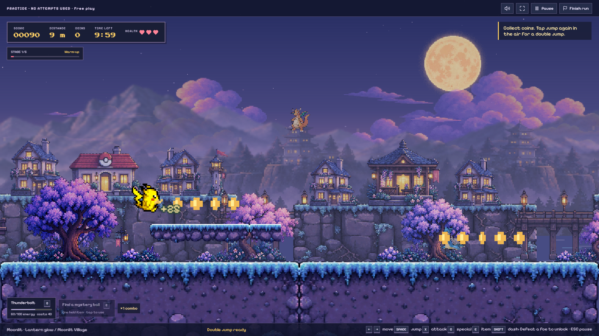

# Pokémon Pixel League

A playable, local-first campus arcade tournament: a React player portal, a real Phaser endless platformer, and an authenticated Express tournament server. The default run lasts two minutes, with three hearts and cosmetic character selection.

## Screenshots

[View the screenshot gallery](docs/screenshots/README.md) or [download all five full-HD screenshots](docs/screenshots/Pokemon-Pixel-League-Screenshots.zip).



## Run locally (Windows PowerShell)

Requires **Node.js 24 or newer** and npm. On Windows use `npm.cmd` if PowerShell blocks `npm.ps1`.

```powershell
cd "C:\Users\shaha\OneDrive\Desktop\pokemon mariokart"
npm.cmd install
npm.cmd run setup
npm.cmd run db:migrate
npm.cmd run seed
npm.cmd run dev
```

Open **http://127.0.0.1:5173/**. The API runs at **http://127.0.0.1:3001/**. `npm run setup` generates an ignored `.env` containing a random organizer password. Organizer username defaults to `organizer`; read `ADMIN_PASSWORD` in your local `.env`. No privileged secret is included in the frontend. Setup preserves an existing `.env`.

Use the **Organizer** link in the footer, sign in, and choose **Start / resume** to allow official runs. The initial tournament state is registration. Practice works independently of tournament status and never consumes an attempt.

Seeding creates **25 example teams and 75 roster members, with zero fabricated scores**. Sign in using a registered team name, such as **Thunder Squad**. Every team starts with **five shared attempts**, independently of roster size. Any member may take the next turn, with only one active run per team.

Production build / single server:

```powershell
npm.cmd run build
npm.cmd start
```

Open **http://127.0.0.1:3001/**. This serves `dist` and `/api` from one origin. Stop either server with Ctrl+C.

## Database and event setup

This implementation deliberately uses **SQLite through Node's built-in `node:sqlite`**, rather than PostgreSQL/Prisma. No PostgreSQL or Docker service was available in the original empty workspace. A single Node server, SQLite WAL, foreign keys, unique constraints, and `BEGIN IMMEDIATE` transactions provide a straightforward persistent event deployment. This is not a PostgreSQL adapter or a multi-server deployment.

The database defaults to `data/league.sqlite`; `DATABASE_PATH` selects a different file. Versioned SQL migrations in `server/migrations/` are applied once by `npm run db:migrate` and at server startup. The shared-pool migration preserves runs, sums existing used attempts, and recalculates cumulative standings, including a frozen leaderboard. Teams, players, allocations, sessions, runs, administrator password hashes, authentication sessions, settings, and audit records persist there.

For the actual event:

1. Stop the development server. Set `DATABASE_PATH=data/event.sqlite` in `.env`.
2. Run `npm.cmd run db:migrate`. **Do not run the demonstration seed against the event database.**
3. Run the server. The configured organizer account is bootstrapped if it does not exist in this database. Changing `.env` does not silently replace an existing account password.
4. Configure maximum roster size, default shared team attempts, duration, and the common seed. Register teams; members sign in with the team name. Change an existing team?s allowance under Teams / roster. Changing the default applies to new teams and resets.
5. Close registration when ready; start the tournament. Existing runs continue if the organizer pauses new starts.
6. Wait for active sessions and pending results before finishing or freezing. Those actions block new result acceptance.
7. Export CSV. Stop the server before making a simple file-copy backup of the database. Preserve the database and audit trail.

For LAN use, change `HOST=0.0.0.0` and use the production server on the host's LAN address; permit the selected port through the host firewall. For remote hosting, use HTTPS behind a reverse proxy and set `COOKIE_SECURE=true`. The default is loopback-only. Do not deploy multiple Node processes against a network-synced SQLite file. For a real event, use a local disk path outside OneDrive's active sync folder, or pause sync while the database is in use.

## Screens and workflow

- Midnight, gold and coral pixel theme with translucent floating Pokemon, local pixel fonts, partner previews, and real leaderboard data.
- Registration with roster limits, unique team names, Pokémon selection, and private per-player codes.
- Searchable/filterable **38-character Pokédex** and a practice run for every partner.
- Team portal with team-name sign-in, roster, accumulated total, attempt history, and shared remaining attempts.
- Explicit official-attempt confirmation; real game; result and submission status; safe retry.
- A consolidated home dashboard with practice, team entry, and all teams? live cumulative standings. Click a team for its accepted attempt history.
- Protected organizer overview, team/roster editing, shared attempt allowances, grants and resets, disqualification/reinstatement, score review, settings, CSV export, and audit history.

## Gameplay and endless generation

World version **5** adds eight animated enemy species and three bosses: Gengar, Onix and Electabuzz. Each has health, warning windows and distinct attack behavior. The six distance stages begin at 0, 200, 500, 900, 1,400 and 2,000 metres. Player speed also ramps from 210 to 270 pixels/second over 80 seconds. Ground gaps stay within 96 pixels; optional rises stay within 72 pixels. Generation validates floor support, hazard clearance, encounter caps and boss bypass routes. Four gameplay chunks and at most 28 scenery tiles stay resident.

Controls: **A/D or arrows** move; **Space/W/up** jumps and double-jumps; **X/J** attacks; **C** uses the partner's energy special; **E** uses the held mystery-ball item; **Shift** dashes after the first enemy defeat. Touch controls provide the same actions. Escape pauses practice. Pikachu, Totodile, Charmander, Squirtle and Bulbasaur have distinct attack kits; other partners use configured elemental archetypes. Official runs retain the organizer's duration; free practice lasts ten minutes.

The world contains spikes, crates, springs, moving/crumbling platforms, thirteen additional hazards, enemy waves and rare elevated secret areas. Mystery balls grant one held item: shield, speed, healing, damage, invincibility, energy, magnet or slow-time. Existing rapid-fire and magnet pickups remain functional; hearts remain rare. Every boss has a warning, health bar, tougher second phase and an escape path. Gengar summons temporary Gastly that cannot be farmed for leaderboard points.

Reusable local pixel-art atlases build six districts: Moonlit Village, Lavender Woodland, Lakeside Bridges, Waterfall Quarter, Castle Highlands and Lantern Walk. Houses have supporting cliffs and visible sprite feet are aligned with their surfaces. Distance grading reduces contrast/saturation and applies subtle cached softness; gameplay stays sharp. Moonlight, dawn, daylight and sunset follow in order with rain, petals, mist, meteors, migration, wind, thunder and lantern events.

The adventure workshop saves coins, achievements, palettes, attack effects, partner mastery and optional practice starting bonuses on this browser. Shinx and Riolu are additional unlockable practice partners. All 38 original partners remain available. Official competition ignores purchased combat upgrades and starting bonuses; cosmetics remain usable. Collected coins plus three workshop coins per defeated enemy fund progression, independently of leaderboard points.

## Scoring and attempt rules

```text
distance = floor(maximum horizontal progress from spawn / 10)
score = distance × 10 + collected coins × 25 + enemy rewards + skill bonuses
enemy reward = species points × combo multiplier (1, 2, 3 or 5)
skill bonuses = airborne/special rewards, dodges and clean sections
team score = SUM of every valid accepted attempt
ties = earliest timestamp that achieved that total, then team creation/id
```

For example, 10,000 + 20,000 + 5,000 = **35,000 team points**. Roster size and attempt allowance are separate: four members can share five attempts, and one member may take several turns. Every accepted run contributes immediately; invalidating a run removes only its contribution.

The server derives the team from an opaque HttpOnly login cookie issued after team-name sign-in. Team names are public identifiers, so this mode assumes a supervised event; they are not private authentication credentials. Legacy player-code logins map into the same shared team pool for compatibility. Admin passwords use salted scrypt hashes. Browser write requests are checked against their request origin, and cookies use SameSite Strict.

Starting an official run atomically checks team membership, tournament state, frozen/disqualified status, remaining allowance, and an existing active session. **One attempt is consumed at start**, not when opening a page or entering practice. A database partial unique index permits only one active version-four-or-later session per team (the start transaction also checks legacy sessions). Refreshing, navigating away, closing the tab, or disconnecting does not refund the attempt. The organizer can grant a replacement with a recorded reason. Resetting closes matching active sessions and restores the configured allowance while retaining historical scores.

The session stores the chosen character, seed, duration, owner, and start time. Results require that session and its authenticated owner. The server validates the result schema, duration, wall-clock timing, speed bounds, score arithmetic, duplicate event IDs, and collectible/enemy IDs and reachability in the seeded world. A result can be submitted up to five minutes after the configured run duration. Identical retries return the original accepted run; conflicting duplicate submissions are rejected. New results update the database and broadcast live standings over SSE.

Completed results are saved locally for retry if browser storage is available. The portal can recover them for the same signed-in team. An interrupted unfinished run cannot be resumed: close it in the portal and contact the organizer. Authentication expires after 12 hours; signing in again preserves database attempts.

**This is plausibility validation, not cheat-proof authoritative gameplay.** A modified browser can synthesize a plausible path. For competitive prizes, use supervised event machines and review flagged results. High-stakes public internet competition would require deterministic input replay or server-authoritative simulation.

## Assets

The roster and background use local PokeAPI Gen V stills/idle GIFs. Gameplay uses **40 playable side-facing motion sets and 11 enemy animation sets** from PMDCollab/SpriteCollab, including original Mystery Dungeon artwork and community contributions. Source animations, per-character credits, licenses, URLs and hashes accompany the local converted 96 x 96 sheets. A public Sprite credits link appears in the footer. These are sourced animations, not newly authored Pokemon art.

Environment art uses local generated sprite atlases, composed by `src/game/landscape.ts`; it does not stretch the reference image across the world. Gameplay obstacle and coin drawing remains in Phaser. **Pixelify Sans** and **Press Start 2P** are bundled locally with SIL Open Font Licenses. Sound cues use Web Audio. No sprite or font CDN is required at runtime.

See [ASSETS.md](ASSETS.md) and `public/assets/pokemon/manifest.json` for per-character sources, hashes, conversion details, and rights notes. Pokémon artwork remains proprietary; repository availability does not establish event/publication permission. Asset permission review remains necessary before public distribution.

## Verification

```powershell
npm.cmd test
npm.cmd run build
```

The automated suite covers registration, associations, character availability, atomic attempts, simultaneous requests, identity/authorization, score validation, duplicate submissions, ranking/ties, live broadcasts, resets, disqualification, tournament states, CSV escaping, and database persistence. Generator checks exercise 20,000 chunks and a long bounded-memory recycling simulation. Asset tests inspect every sheet's geometry.

Browser QA used a **separate database** and included registration → Eevee selection → actual keyboard play → accepted 745-point result → leaderboard → organizer reset → another accepted run → server restart → persisted standings. Desktop and 390-pixel mobile layouts were inspected. See [TESTING.md](TESTING.md).

To run an isolated manual QA instance after building:

```powershell
node_modules\.bin\tsx.cmd scripts/qa-server.ts
```

It serves `http://127.0.0.1:3002`, uses `data/browser-qa.sqlite`, and has test-only credentials `qa-organizer` / `qa-only-password`. Never use that script for an event.

## Source map

```text
src/pages/             landing, registration, player portal
src/components/        roster, leaderboard, organizer screens
src/game/              Phaser scene, native art, audio, React integration
src/pendingResult.ts   per-team browser recovery of completed results
shared/world.ts        deterministic generation and scoring rules
shared/roster.ts       playable character catalog
server/app.ts          validated and authorized REST/SSE endpoints
server/db.ts           SQL access, transactions, ranking, password/code hashing
server/migrations/     persistent schema and constraints
scripts/               setup, migration, demo seed, isolated QA server
tests/                 tournament/API, concurrency, assets, world invariants
public/assets/         local character art and fonts with provenance
```

## Remaining limits before the college event

- Run a rehearsal on the actual projector/laptops and target network. The automated 25-player API check is not a 25-browser, two-minute graphics/load soak.
- Pokémon art permissions need review; the sourced motion sets and original Pokemon rights are described in ASSETS.md.
- Single-host SQLite only. PostgreSQL migration, distributed deployment, and database-backed rate limiting are not implemented.
- Fixed scoring and base movement are intentional for fairness. Duration, roster size, attempts, and seed are configurable; score multipliers and a no-time-limit mode are not exposed.
- Eight encounter families have bounded seeded variations; this remains a finite content set, not an unlimited library of unique obstacle designs.
- No input replay or server-authoritative physics, self-service account recovery, or automatic interrupted-run refunds.
- The Phaser runtime is lazy loaded but remains a large bundle (~340 KB gzip); the production build reports this expected chunk warning.
- Public deployment, HTTPS/reverse-proxy setup, an actual multi-device stress rehearsal, and long-duration gameplay soak remain outside the completed local verification.

The expansion requirement map is in [EXPANSION.md](EXPANSION.md). Version 1?4 worlds remain available for previously reserved sessions.
